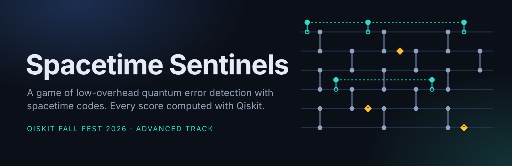
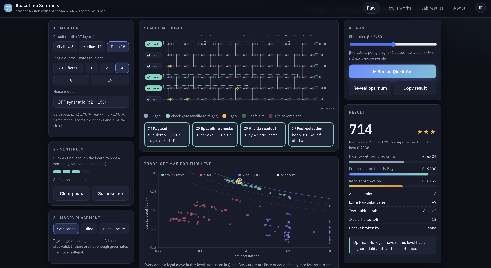
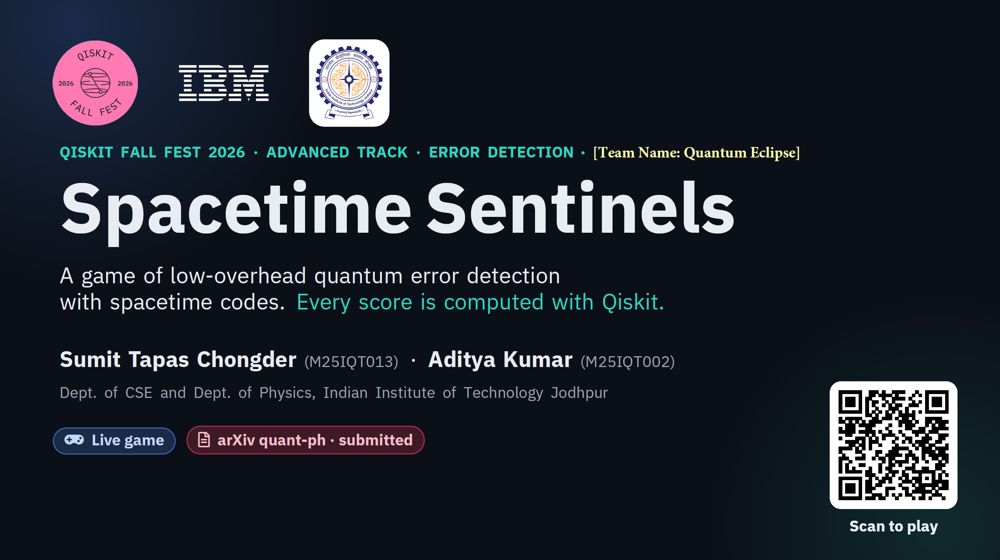
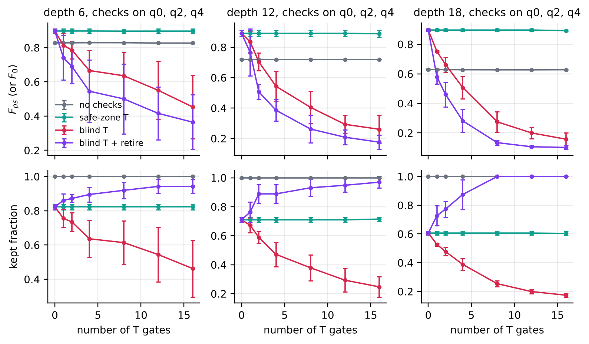
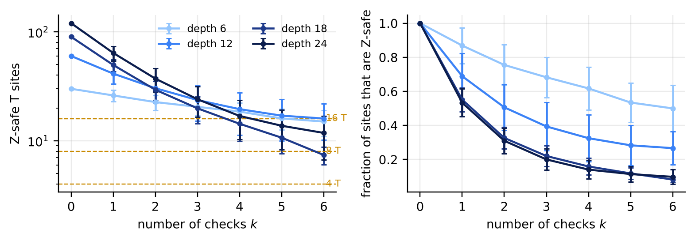
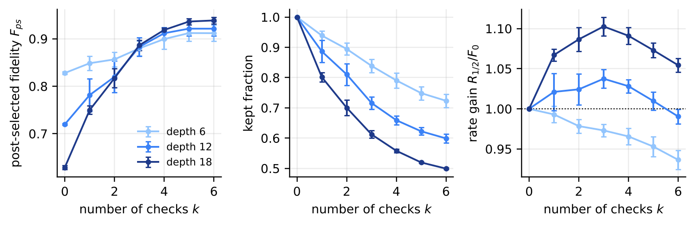

<div align="center">

<a href="https://sumitchongder.github.io/spacetime-sentinels/"></a>

# Spacetime Sentinels

### A game of low-overhead quantum error detection with spacetime codes. Every score is computed with Qiskit.

[](https://github.com/Sumitchongder/spacetime-sentinels/actions/workflows/ci.yml)
[](https://sumitchongder.github.io/spacetime-sentinels/)


[](LICENSE)


[](https://sumitchongder.github.io/spacetime-sentinels/)
[](#-video-walkthrough)
[-0F9F8F?style=for-the-badge&labelColor=0B0F17)](report/main.pdf)
[](#-paper-and-arxiv-preprint)


**Qiskit Fall Fest 2026 · IIT Jodhpur · Advanced track**<br>
*Gamifying Error Detection, Mitigation and Correction: error-detection track*

**Sumit Tapas Chongder\* · Aditya Kumar\***<br>
Department of Computer Science & Engineering and Department of Physics<br>
Indian Institute of Technology Jodhpur<br>
<sub>\* equal contribution</sub>

[**Play**](https://sumitchongder.github.io/spacetime-sentinels/) · [**Watch**](#-video-walkthrough) · [**Read**](report/main.pdf) · [Key results](#-key-results) · [Judging criteria](#-how-this-submission-meets-the-judging-criteria) · [Run it yourself](#-quick-start)

</div>

---

## 🎮 Play the game

<div align="center">

<a href="https://sumitchongder.github.io/spacetime-sentinels/">

</a>

**[`🔗 https://sumitchongder.github.io/spacetime-sentinels/`](https://sumitchongder.github.io/spacetime-sentinels/)**<br>
<sub>Runs in any browser, desktop or phone. No install, no login.</sub>

<br>

<a href="https://sumitchongder.github.io/spacetime-sentinels/"></a>

<sub>After applying sentinels to the qubits, press Run, and see the score that Qiskit Aer computed for your move.</sub>

</div>

---

## 🎬 Video walkthrough

<div align="center">

<a href="https://youtu.be/TBfH10EU_gI">



</a>

**[▶ Watch the full walkthrough (12:52, 1080p)](https://youtu.be/TBfH10EU_gI)** · [Slides (PDF)](presentation/slides.pdf)


---

## 📄 Paper and arXiv preprint

<div align="center">

<a href="report/main.pdf"></a>

</div>

> **Spacetime Sentinels: a Qiskit game that exposes the competition between spacetime checks and magic in low-overhead quantum error detection**<br>
> Sumit Tapas Chongder and Aditya Kumar, IIT Jodhpur, October 2026.<br>
> 📮 **Submitted to arXiv [quant-ph]** (under moderation; the arXiv identifier will be added here once it is announced).

The report covers the game design, the physics of every rule, the methods behind the six challenge steps, validation against shot-based runs, and four findings with figures. LaTeX source is in [`report/`](report).

---

## 💡 The idea in one paragraph

You are given a noisy six-qubit circuit and four spare qubits. Post **sentinels** (spacetime Pauli checks from `qiskit-paulice`) on the qubits you want to guard, then add a quota of **T gates** and decide where they go. Press **Run**: the move is simulated exactly with Qiskit Aer, every shot whose sentinels raise an alarm is thrown away, and you score the **fidelity rate** `R = F_ps · keep^β` of what survives. Behind the game sit three trade-offs that most people do not guess before playing:

<table>
<tr>
<td width="33%" valign="top">

### ⚖️ Break-even depth
Checks only pay on deep enough circuits. On shallow ones, the noise of the check gates outweighs the errors they catch.

</td>
<td width="33%" valign="top">

### ✨ Protection vs magic
T gates add no noise on IBM hardware, yet every check removes places where a T gate can go without breaking it. With four checks at depth 18, the safe sites fall **from 90 to about 14**.

</td>
<td width="33%" valign="top">

### 💥 Broken is worse than none
A check broken by a misplaced T gate hurts fidelity, and it keeps hurting even after you stop listening to it.

</td>
</tr>
</table>

---

## 📊 Key results

<p align="center"></p>

*Average over five random payloads, checks on q0, q2, q4. Placing T gates in safe zones keeps both fidelity and kept fraction flat as magic is added. Blind placement breaks checks and both collapse.*

| Finding (5 random payloads unless noted) | Number |
|---|---|
| Fidelity-rate gain R/F₀ with the best number of checks, depth 6 / 12 / 18 | 1.000 (no number of checks pays) / 1.037 (k = 3) / **1.103** (k = 3) |
| Post-selected fidelity at depth 18, three checks | F₀ 0.629 → **F_ps 0.886** at keep 0.612 |
| Depth 18 with 16 T gates: F_ps for safe / blind / blind + retire / no checks | **0.892** / 0.158 / 0.102 / 0.628 |
| Z-safe T sites at depth 18 with 0 / 2 / 4 / 6 checks (of 90) | 90.0 / 29.4 / **14.3** / 7.4 |
| Game's deep level, 16 T: best move | checks on q2, q3 (safe), gain ×1.120; 13 moves illegal for lack of safe sites |
| Exact simulation vs 50,000-shot `SamplerV2` runs (20 configurations) | largest deviation **1.4 σ** in kept fraction |

<p align="center">


</p>

---

## 🏆 How this submission meets the judging criteria

| Criterion (weight) | What we did | Where to look |
|---|---|---|
| **Presentation (40 %)** | A live, polished game; a 13-minute narrated video; a 12-page paper submitted to arXiv; every rule mapped to the physics; design choices justified; honest limitations | [Game](https://sumitchongder.github.io/spacetime-sentinels/) · [Video](#-video-walkthrough) · [Report](report/main.pdf) · [Slides](presentation/slides.pdf) |
| **Effect (30 %)** | Three non-obvious trade-offs backed by numbers: break-even depth, protection vs magic capacity, broken checks worse than none. The best checks change with the T quota | Report §5 · [`results/`](results) |
| **Methods (20 %)** | Doping lemma, coherent syndrome equivalence, exact density matrices, stabilizer and statevector references; scores come from Qiskit only; validated with shot-based runs | Report §2, §4 · [`tests/`](tests) |
| **Qiskit (10 %)** | `qiskit-paulice` (`add_pauli_checks`, `NoiseModel`, `from_backend`, `uncovered_paulis`, `get_postselection_method`), `quantum_info`, Aer density matrix and `SamplerV2`, `FakeFez`; current Qiskit 2.x APIs; reproducible notebook | [`src/sentinels`](src/sentinels) · [`notebooks`](notebooks) |

### Deliverables checklist

| Requirement | Status | Link |
|---|:---:|---|
| Playable game | ✅ | **https://sumitchongder.github.io/spacetime-sentinels/** and `sentinels play` in a terminal |
| Recorded presentation | ✅ | [Video walkthrough](#-video-walkthrough) · [slides](presentation/slides.pdf) · [script](presentation/VIDEO_SCRIPT.md) |
| Written report | ✅ | [`report/main.pdf`](report/main.pdf), submitted to arXiv [quant-ph] |
| Complete, runnable source code | ✅ | [`src/sentinels`](src/sentinels) · [`experiments`](experiments) · [`tests`](tests) · [`notebooks/01_walkthrough.ipynb`](notebooks/01_walkthrough.ipynb) |

---

## 🧭 Where the game sits

| | What it does | Cost | In this game? |
|---|---|---|---|
| **Error detection** | Ancilla checks flag the errors they can see; those shots are discarded. Nothing is repaired. | ancillas, extra gates, discarded shots | ✅ **This is the whole game** (our track) |
| Error mitigation | Corrects the *estimate* of an observable afterwards (ZNE, PEC, twirling, readout correction). | extra circuits and shots | Not in play. The score's β = ½ assumes a rescaling step after detection |
| Error correction | Encodes logical qubits, measures stabilizers repeatedly, a decoder undoes errors. | many qubits, fast decoding | Not in play |

The prompt offers three separate tracks. We chose error detection and went deep on it.

## 📜 Rules and the physics behind them

| Game rule | Physics | Computed by |
|---|---|---|
| Six wires, columns of CZ gates | 6-qubit brickwork Clifford payload (IBM tutorial family), 6, 12 or 18 CZ layers | `QuantumCircuit` |
| **Post a sentinel** (budget 4) | One ancilla + one spacetime check on that qubit: controlled X/Y/Z at a few moments, then measured | `qiskit_paulice.add_pauli_checks(cost="gamma", method="windowed")` |
| Syndrome parities at readout | Output bits XORed with the ancilla bit form the syndrome | `CheckedCircuit.check_support` |
| **Green / red sites** | Every check acts as I or Z there (T commutes) / some check acts as X or Y (T breaks it) | `CheckedCircuit.uncovered_paulis` |
| **Magic quota** (0 to 16 T) | Non-Clifford resource, added after the checks are found | T inserted into the checked circuit |
| **Safe / Blind / Blind + retire** | Doping policy. TXT† = (X+Y)/√2 is not a Pauli, so a T on a red site breaks a check | noiseless `Statevector` validity test |
| **Run** | payload → checks → ancilla readout → post-selection under the announced noise model | Qiskit Aer density matrix (exact) |
| **Score** `1000 · F_ps · keep^β` | Fidelity rate. β = ½ is the signal-to-noise per √shot; `R⁻²` is the sampling overhead | `sentinels.scoring` |

## 🔬 How every score is computed (the six challenge steps)

1. **Payload.** Brickwork Clifford circuit, 6 qubits, depth d ∈ {6, 12, 18}; the T-doped family adds 1, 2, 4, 8 or 16 T gates.
2. **Reference.** `StabilizerState` for Clifford circuits, `Statevector` for T-doped ones. **Fidelity:** state fidelity ⟨ψ|σ|ψ⟩ of the post-selected data, which sees phase errors that output-distribution distances miss (the deep payload has F₀ = 0.637 but a classical fidelity of 1.000).
3. **Checks.** `add_pauli_checks` with one ancilla per chosen target, deterministic `gamma` + `windowed` setting.
4. **Noise.** The announced `NoiseModel(gate_noise=0.01)` with 1 % readout, used to pick checks and to simulate. A second profile comes from FakeFez calibration data (p₂ = 0.0048, p_ro = 0.0088). T gates are noiseless (virtual RZ).
5. **Measure.** F₀ without checks, F_ps with checks, kept fraction, added cost (ancillas, two-qubit gates, depth), broken checks, Z-safe sites.
6. **Compare.** All **5,412** legal moves were evaluated, and the best trade-off of each level is identified and explained in the report.

---

## 🚀 Quick start

```bash
git clone https://github.com/Sumitchongder/spacetime-sentinels.git
cd spacetime-sentinels
python -m venv .venv && source .venv/bin/activate      # Windows: .venv\Scripts\activate
pip install -r requirements.txt && pip install -e ".[dev]"
sentinels play                                          # play one round, computed live with Qiskit
```

```bash
sentinels evaluate --depth 18 --targets 0,3,4 --t 4 --policy safe   # one move, full JSON record
pytest                                                              # physics invariants + validation tests
jupyter notebook notebooks/01_walkthrough.ipynb                     # the six challenge steps, reproducibly
make serve                                                          # web game at http://localhost:8000
```

### Reproduce everything (laptop or HPC)

```bash
make reproduce          # grid -> experiments -> figures -> web data -> report  (about 2 h on 2 cores)
```

| Target | What it does |
|---|---|
| `make grid` | Evaluates every legal move for both noise models ([`experiments/e0_game_grid.py`](experiments/e0_game_grid.py)) |
| `make experiments` | E1 check count · E2 T count · E3 magic capacity · E5 noise sweep · E6 validation · E7 noisy-T ablation |
| `make figures web report slides` | Figures, `docs/data`, `report/main.pdf`, `presentation/slides.pdf` |

**HPC.** [`scripts/hpc/grid_array.slurm`](scripts/hpc/grid_array.slurm) runs one Slurm array task per (noise model, depth) and [`merge_grids.py`](scripts/hpc/merge_grids.py) merges them. Configurations are independent, so the sweep scales linearly with cores. `--device GPU` switches Aer to `qiskit-aer-gpu` ([`grid_gpu.slurm`](scripts/hpc/grid_gpu.slurm)). A [`Dockerfile`](Dockerfile) and [`environment.yml`](environment.yml) pin the environment.

<details>
<summary><b>📁 Repository layout</b></summary>

```
spacetime-sentinels/
├── src/sentinels/          # the Python package
│   ├── payloads.py         #   brickwork Clifford payloads and T sites
│   ├── noise.py            #   shared noise profiles for qiskit-paulice and Aer
│   ├── checks.py           #   qiskit-paulice wrapper, Z-safe sites, doping
│   ├── fidelity.py         #   exact post-selected fidelity (Aer density matrix)
│   ├── sampling.py         #   SamplerV2 shot-based validation
│   ├── scoring.py          #   fidelity rate, stars, Pareto front
│   ├── experiment.py       #   configuration evaluation and grid sweep
│   ├── export.py           #   JSON for the web game
│   └── cli.py              #   `sentinels play | evaluate | grid | export`
├── experiments/            # E0 to E7 and figure/number generation
├── results/                # data (CSV, JSON) and figures (PDF, PNG)
├── docs/                   # the GitHub Pages game (static, no build step)
├── notebooks/              # reproducible walkthrough of the six challenge steps
├── report/                 # LaTeX source and main.pdf
├── presentation/           # slides and video script
├── tests/                  # physics invariants and validation
├── scripts/                # run_all.sh, Slurm array and GPU jobs
└── configs/                # parameters used for every result
```

</details>

## ⚠️ Limitations

- Six data qubits and at most four checks per move, so that every move is simulated exactly. Trends hold over five random payloads, but larger circuits may behave differently.
- Uniform Pauli noise, no idling noise (also ignored by the current check picker).
- The syndrome parity is computed coherently in simulation; in an experiment it is classical post-processing with identical statistics.
- The web game plays back pre-computed Qiskit results for every legal move; `sentinels play` computes moves live.

## 📚 Citation

```bibtex
@misc{chongder_kumar_2026_sentinels,
  author       = {Chongder, Sumit Tapas and Kumar, Aditya},
  title        = {Spacetime Sentinels: a Qiskit game that exposes the competition between
                  spacetime checks and magic in low-overhead quantum error detection},
  year         = {2026},
  note         = {Submitted to arXiv [quant-ph]},
  howpublished = {\url{https://github.com/Sumitchongder/spacetime-sentinels}}
}
```

## 🤖 AI disclosure

AI assistants (Anthropic's Claude) were used to help write and refactor code, draft documentation, edit the report. The authors chose the research questions and the game design, checked the physics, ran and inspected every experiment, and take responsibility for all content. Details are in the report.

## 🙏 Acknowledgements

Built for the Qiskit Fall Fest 2026 Hackathon (Advanced Track) hosted by IIT Jodhpur, on the prompt by Wenyu Sun (McGill University) provided by IBM Quantum. We build on `qiskit-paulice` and the method of S. Martiel and A. Javadi-Abhari (arXiv:2504.15725), the doping construction of Martiel *et al.* (arXiv:2607.25941), and the game design of D. Litinski's *A Game of Surface Codes* (Quantum 3, 128, 2019). Licensed under [Apache 2.0](LICENSE).

<div align="center">

---

**[▶ Play the game](https://sumitchongder.github.io/spacetime-sentinels/)** · **[🎬 Watch the video](#-video-walkthrough)** · **[📄 Read the report](report/main.pdf)**

<sub>Protection and magic compete for the same spacetime.</sub>

</div>
