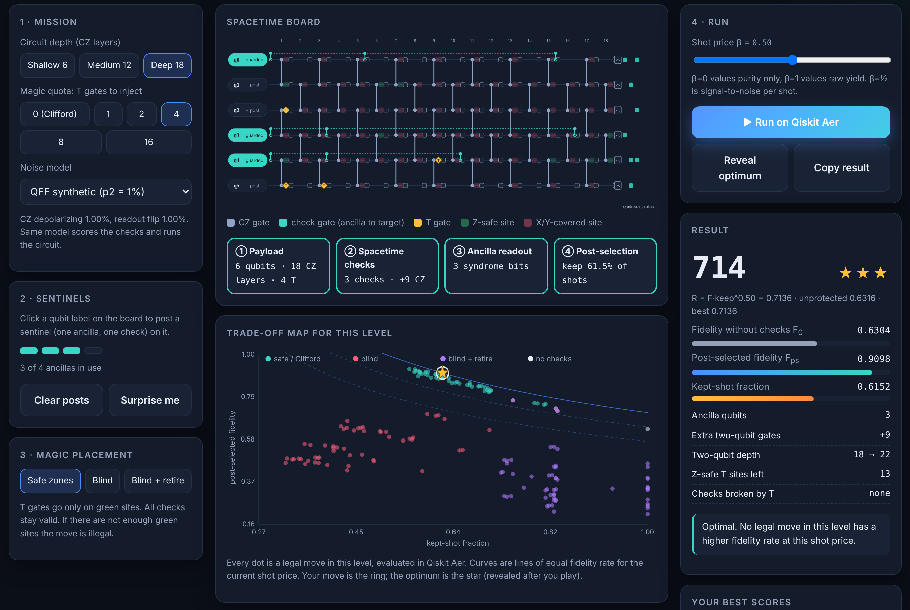

<div align="center">


# Spacetime Sentinels

**A game of low-overhead quantum error detection with spacetime codes. Every score is computed with Qiskit.**

[](https://OWNER.github.io/spacetime-sentinels/)
[](report/main.pdf)
[](#video-walkthrough)

[](https://github.com/OWNER/spacetime-sentinels/actions/workflows/ci.yml)


[](LICENSE)

*Qiskit Fall Fest 2026 · IIT Jodhpur · Advanced track · "Gamifying Error Detection, Mitigation and Correction" (error-detection track)*

**Sumit Tapas Chongder\* · Aditya Kumar\***
Department of Computer Science & Engineering and Department of Physics, Indian Institute of Technology Jodhpur
<sub>\* equal contribution</sub>

</div>

---

## In one paragraph

You are given a noisy six-qubit Clifford circuit and four ancilla qubits. Post **sentinels** (spacetime Pauli checks from `qiskit-paulice`) on the qubits you want to guard, then inject a quota of **T gates** and decide where they go. Press **Run**: the move is simulated exactly with Qiskit Aer, every shot with a non-trivial syndrome is discarded, and you score the **fidelity rate** `R = F_ps · keep^β` of what survives. The game hides three trade-offs that most people do not guess before playing:

1. **Checks only pay above a break-even depth.** On shallow circuits the noise of the check gates outweighs what they catch.
2. **T gates are free on the hardware but not for the code.** They add no noise (virtual RZ), yet every check you add removes the places where a T gate can go without breaking a check. *Protection and magic compete for the same spacetime.*
3. **A broken check is worse than no check**, and it keeps hurting even after you stop listening to it.

<p align="center"></p>

## Contents

- [Deliverables](#deliverables)
- [Where the game sits: detection, mitigation, correction](#where-the-game-sits)
- [Rules and the physics behind them](#rules-and-the-physics-behind-them)
- [How every score is computed](#how-every-score-is-computed)
- [Key results](#key-results)
- [Quick start](#quick-start)
- [Reproduce everything (laptop or HPC)](#reproduce-everything)
- [How this submission meets the judging criteria](#judging-criteria)
- [Repository layout](#repository-layout)
- [Limitations](#limitations) · [Citation](#citation) · [AI disclosure](#ai-disclosure) · [Acknowledgements](#acknowledgements)

## Deliverables

| Requirement | Where |
|---|---|
| Complete, runnable source code | [`src/sentinels`](src/sentinels), [`experiments`](experiments), [`tests`](tests), [`notebooks/01_walkthrough.ipynb`](notebooks/01_walkthrough.ipynb) |
| Recorded presentation | [Video walkthrough](#video-walkthrough) · slides: [`presentation/slides.pdf`](presentation/slides.pdf) · script: [`presentation/VIDEO_SCRIPT.md`](presentation/VIDEO_SCRIPT.md) |
| Written report | [`report/main.pdf`](report/main.pdf) (LaTeX source in [`report/`](report)) |
| Playable game | **https://OWNER.github.io/spacetime-sentinels/** and `sentinels play` in a terminal |

### Video walkthrough

> VIDEO_LINK_PLACEHOLDER

## Where the game sits

| | What it does | Cost | In this game? |
|---|---|---|---|
| **Error detection** | Ancilla checks flag the errors they can see; those shots are discarded. Errors outside the checks pass through. Nothing is repaired. | ancillas, extra gates, discarded shots | **Yes, this is the whole game** |
| Error mitigation | Leaves the hardware alone and corrects the *estimate* of an observable afterwards (ZNE, PEC, twirling, readout correction). | extra circuits and shots | No (the score's β = ½ assumes a rescaling step after detection) |
| Error correction | Encodes logical qubits in many physical ones, measures stabilizers repeatedly, a decoder undoes errors during the run. | many qubits, fast decoding | No |

## Rules and the physics behind them

| Game rule | Physics | Computed by |
|---|---|---|
| Six wires, columns of CZ gates | 6-qubit brickwork Clifford payload (same family as the IBM tutorial), 6, 12 or 18 CZ layers | `QuantumCircuit` |
| **Post a sentinel** (budget 4) | One ancilla + one spacetime check on that target qubit: controlled X/Y/Z at a few moments, then measured | `qiskit_paulice.add_pauli_checks(cost="gamma", method="windowed")` |
| Teal probes on a wire | Moments where the check touches its target | the checked circuit |
| Syndrome parities at readout | Output bits XORed with the ancilla bit to form the syndrome | `CheckedCircuit.check_support` |
| **Green / red sites** | Every check acts as I or Z there, so a T gate commutes with all checks / some check acts as X or Y | `CheckedCircuit.uncovered_paulis` |
| **Magic quota** (0 to 16 T) | Non-Clifford resource; `add_pauli_checks` only accepts Clifford circuits, so T is added afterwards | T inserted into the checked circuit |
| **Safe zones / Blind / Blind + retire** | Doping policy. A T on a red site breaks a check (TXT† = (X+Y)/√2 is not a Pauli) | noiseless `Statevector` validity test |
| **Run** | payload → checks → ancilla readout → post-selection, under the announced noise model | Qiskit Aer density matrix (exact) |
| **Score** `1000 · F_ps · keep^β` | Fidelity rate. β = ½ is the signal-to-noise per √shot; `R^-2` is the sampling overhead of detection followed by rescaling | `sentinels.scoring` |

## How every score is computed

1. **Payload.** Brickwork Clifford circuit, 6 qubits, depth d ∈ {6, 12, 18}; the T-doped family adds 1, 2, 4, 8 or 16 T gates.
2. **Reference.** Stabilizer simulation (`StabilizerState`) for the Clifford circuit, statevector (`Statevector`) for T-doped circuits. **Fidelity measure:** state fidelity ⟨ψ|σ|ψ⟩ of the post-selected data register, because it sees every error, including phase errors that an output-distribution distance misses (the deep Clifford payload has F₀ = 0.637 but a classical fidelity of 1.000).
3. **Checks.** `add_pauli_checks` with one ancilla per chosen target; deterministic `gamma` + `windowed` setting.
4. **Noise.** The model announced in the challenge, `NoiseModel(gate_noise=0.01)` with 1 % readout, used both to pick checks and to simulate. A second profile is derived from FakeFez calibration data (p₂ = 0.0048, p_ro = 0.0088). T gates are noiseless (virtual RZ).
5. **Measure.** For every configuration: F₀ without checks, F_ps with checks, kept fraction, added cost (ancillas, two-qubit gates, depth), broken checks, Z-safe sites.
6. **Compare.** All **5,412** legal moves were evaluated; the best trade-off of each level is identified and explained in the report.

Validated against 50,000-shot runs of the Aer `SamplerV2` primitive (largest deviation 1.4 σ in kept fraction).

## Key results

<p align="center"></p>

*Average over five random payloads, checks on q0, q2, q4. Safe-zone doping keeps both fidelity and kept fraction flat as T gates are added; blind doping breaks checks and collapses both.*

| Finding (5 random payloads unless noted) | Number |
|---|---|
| Fidelity-rate gain R/F₀ with the best number of paulice checks, depth 6 / 12 / 18 | 1.000 (k = 0: no number of checks pays in this sweep) / 1.037 (k = 3) / 1.103 (k = 3) |
| Post-selected fidelity at depth 18, best number of checks (3) | F₀ 0.629 → F_ps 0.886 at keep 0.612 |
| Depth 18, 16 T gates: F_ps safe / blind / blind+retire / no checks | 0.892 / 0.158 / 0.102 / 0.628 |
| Z-safe T sites at depth 18 with 0 / 2 / 4 / 6 checks (of 90) | 90.0 / 29.4 / 14.3 / 7.4 |
| Game's deep level, 16 T: best move | checks on q2,q3 (safe), gain ×1.120; 13 moves illegal for lack of safe sites |

<p align="center">


</p>

## Quick start

```bash
git clone https://github.com/OWNER/spacetime-sentinels.git
cd spacetime-sentinels
python -m venv .venv && source .venv/bin/activate      # Windows: .venv\Scripts\activate
pip install -r requirements.txt && pip install -e ".[dev]"
sentinels play                                          # play one round, computed live with Qiskit
```

Other entry points:

```bash
sentinels evaluate --depth 18 --targets 0,3,4 --t 4 --policy safe   # one move, full JSON record
pytest                                                              # physics invariants + validation tests
jupyter notebook notebooks/01_walkthrough.ipynb                      # the six challenge steps, reproducibly
make serve                                                          # web game at http://localhost:8000
```

## Reproduce everything

```bash
make reproduce          # grid -> experiments -> figures -> web data -> report  (about 2 h on 2 cores)
```

| Target | What it does |
|---|---|
| `make grid` | Evaluates every legal move for both noise models ([`experiments/e0_game_grid.py`](experiments/e0_game_grid.py)) |
| `make experiments` | E1 check count · E2 T count · E3 magic capacity · E5 noise sweep · E6 validation · E7 noisy-T ablation |
| `make figures web report slides` | Figures, `docs/data`, `report/main.pdf`, `presentation/slides.pdf` |

**HPC.** [`scripts/hpc/grid_array.slurm`](scripts/hpc/grid_array.slurm) runs one Slurm array task per (noise model, depth) and [`merge_grids.py`](scripts/hpc/merge_grids.py) merges them. Configurations are independent, so the sweep scales linearly with cores. `--device GPU` switches Qiskit Aer to `qiskit-aer-gpu` for larger studies ([`grid_gpu.slurm`](scripts/hpc/grid_gpu.slurm)). A [`Dockerfile`](Dockerfile) and [`environment.yml`](environment.yml) pin the environment.

## Judging criteria

| Criterion (weight) | What we did | Where |
|---|---|---|
| **Presentation (40 %)** | Every rule mapped to the physics; design choices justified (why paulice picks the check internals, why bad options stay legal, why β = ½); honest limitations | Report §3, §6; video; README tables above |
| **Effect (30 %)** | Three non-obvious trade-offs backed by numbers: break-even depth, protection-vs-magic capacity, broken checks worse than none. Optimal checks change with the T quota | Report §5; [`results/`](results) |
| **Methods (20 %)** | Correct physics (doping lemma, coherent syndrome equivalence, exact density matrices, stabilizer/statevector references); scores from Qiskit only; original mechanic | Report §2, §4; [`tests/`](tests) |
| **Qiskit (10 %)** | `qiskit-paulice` (`add_pauli_checks`, `NoiseModel`, `from_backend`, `uncovered_paulis`, `get_postselection_method`), `quantum_info`, Aer density matrix and `SamplerV2` primitive, fake backend; current Qiskit 2.x APIs; reproducible notebook | [`src/sentinels`](src/sentinels), [`notebooks`](notebooks) |

## Repository layout

```
spacetime-sentinels/
├── src/sentinels/          # the Python package
│   ├── payloads.py         #   brickwork Clifford payloads and T sites
│   ├── noise.py            #   shared noise profiles for qiskit-paulice and Aer
│   ├── checks.py           #   qiskit-paulice wrapper, Z-safe sites, doping
│   ├── fidelity.py         #   exact post-selected fidelity (Aer density matrix)
│   ├── sampling.py         #   SamplerV2 shot-based validation
│   ├── scoring.py          #   fidelity rate, stars, Pareto front
│   ├── experiment.py       #   configuration evaluation and grid sweep
│   ├── export.py           #   JSON for the web game
│   └── cli.py              #   `sentinels play | evaluate | grid | export`
├── experiments/            # E0 to E7 and figure/number generation
├── results/                # data (CSV, JSON) and figures (PDF, PNG)
├── docs/                   # the GitHub Pages game (static, no build step)
├── notebooks/              # reproducible walkthrough of the six challenge steps
├── report/                 # LaTeX source and main.pdf
├── presentation/           # slides and video script
├── tests/                  # physics invariants and validation
├── scripts/                # run_all.sh, Slurm array and GPU jobs
└── configs/                # parameters used for every result
```

## Limitations

- Six data qubits and at most four checks per move so that every move is simulated exactly; trends hold over five random payloads but larger circuits may behave differently.
- Uniform Pauli noise, no idling noise (also ignored by the current check picker).
- The syndrome parity of output bits is computed coherently in simulation; it is classical post-processing in an experiment and gives identical measurement statistics.
- The web game plays back pre-computed Qiskit results for every legal move; `sentinels play` computes moves live.

## Citation

```bibtex
@software{chongder_kumar_2026_sentinels,
  author  = {Chongder, Sumit Tapas and Kumar, Aditya},
  title   = {Spacetime Sentinels: a game of low-overhead quantum error detection with spacetime codes},
  year    = {2026},
  url     = {https://github.com/OWNER/spacetime-sentinels},
  version = {1.0.0}
}
```

## AI disclosure

AI assistants (Anthropic's Claude) were used to help write and refactor code, draft documentation and edit the report text. The authors chose the research questions and the game design, checked the physics, ran and inspected every experiment, and take responsibility for all content. Details are in the report.

## Acknowledgements

Built for the Qiskit Fall Fest 2026 hackathon hosted by IIT Jodhpur, on the prompt by Wenyu Sun (McGill University) provided by IBM Quantum. We build on `qiskit-paulice` and the method of S. Martiel and A. Javadi-Abhari (arXiv:2504.15725), the doping construction of Martiel *et al.* (arXiv:2607.25941), and the game design of D. Litinski's *A Game of Surface Codes* (Quantum 3, 128, 2019). Licensed under [Apache 2.0](LICENSE).
